<p align="center">
  
</p>

<h1 align="center">Pratibimb</h1>

<p align="center">
  <b>A digital twin for Indian adults with hypertension.</b><br>
  It joins the health record with a Rs 2,000 watch and a home BP cuff, learns how this one person's body responds to sleep and walking,<br>
  and warns the doctor up to 72 hours before a cardiovascular strain episode.
</p>

<p align="center">
  <a href="https://pratibimb.vercel.app"><b>Open the live demo</b></a> &nbsp;|&nbsp;
  <a href="docs/presentation.pdf">Presentation</a> &nbsp;|&nbsp;
  <a href="docs/ALGORITHM.md">Algorithm</a> &nbsp;|&nbsp;
  <a href="docs/architecture.pdf">Architecture</a> &nbsp;|&nbsp;
  <a href="docs/MODEL_CARD.md">Model card</a> &nbsp;|&nbsp;
  <a href="#video">Video</a>
</p>

> **Live demo:** <https://pratibimb.vercel.app> replays real output from the trained model in the browser, with no install. To run the API and retrain the model yourself, see [Run it](#run-it).
>
> Research proof of concept on synthetic data. Not a medical device. Not a substitute for emergency services. If you feel unwell, call 112.

---

## At a glance

| | |
|---|---|
| **Condition** | Hypertension with cardiovascular risk (about 1 in 4 Indian adults) |
| **Event predicted** | Cardiovascular strain episode, onset within the next **72 hours** |
| **Streams fused** | Static EHR (FHIR R4) + daily wearable stream (heart rate, HRV, sleep, steps, SpO2, home BP) |
| **Core algorithm** | Personal Physiology Engine (empirical Bayes) feeding a calibrated LightGBM fusion model |
| **Accuracy** | AUROC **0.876**, catches **70%** of episodes at 1 false alert per 22 patient-days, median lead **48 h** |
| **Twin lift** | Twin adjustment adds **+0.025 AUROC** and **+7 points** of sensitivity (3 of 3 patient splits) |
| **Doctor view** | Triage, twin page, what-if simulator, alerts with a false-alert budget, threshold replay, model card, audit log |
| **Patient view** | Plain-language card in English and Hindi, what helps you most, check-in, press-and-hold SOS with a consented ladder |
| **Data** | 240 synthetic patients x 120 days, seeded and reproducible; no real patient data anywhere |

## Evaluate it in five minutes

Every requirement in the brief, where to see it, and the proof.

| The brief asks for | Where to see it (live demo) | Proof in the repo |
|---|---|---|
| **One condition prevalent in India** | Landing page; twin page header | [Problem statement](#problem-statement-and-healthcare-use-case) |
| **Static EHR data** | Twin page, Records tab (conditions, labs, medicines, family history, genetic tier) | `backend/twin/data/ehr.py`, FHIR bundles in `data/synthetic/fhir/` |
| **Dynamic wearable stream** | Twin page, Twin tab (three linked charts, live stream ticking) | `backend/twin/data/wearables.py`, `docs/DEVICE_SYNC.md` |
| **Fusion of the two** | "Why this score" splits each reason into record and watch | `backend/twin/models/fusion.py`, ablation table below |
| **Virtual replica of the patient** | Twin page, "How Meera's body responds" (her own learned slopes) | `backend/twin/models/physiology.py`, recovery test below |
| **The algorithm, explained** | Evaluator guide, "How the algorithm works" | [`docs/ALGORITHM.md`](docs/ALGORITHM.md), worked on one patient with real numbers |
| **Predicts an adverse event ahead** | Triage list (72 h probability with band), forecast fans | Model card, leakage tests |
| **Personalise treatment** | Simulate tab: walking and sleep use her own slopes | `TwinService.simulate` |
| **Doctor interacts with the virtual patient** | Console: acknowledge, snooze, escalate, annotate, change thresholds with a 14 day replay | `docs/API.md`, audit log page |
| **Synthetic, open or anonymised data only** | Every screen badges SIMULATED data | `docs/DATA_SOURCES.md` |
| **Proactive, not reactive** | Alerts arrive a median 48 h before the event; check-in ladder starts with the patient | Results, `docs/COMPLIANCE.md` |

Suggested path: **Evaluator guide** then **Today** (triage) then **Meera Iyer** (P-0007) then the **Twin** and **Simulate** tabs then **Alerts** then the **Patient view** (hold SOS) then **Model**.

## Team details and college

| | |
|---|---|
| **Team** | Team Pratibimb |
| **College** | Indian Institute of Management Lucknow |
| **Team leader** | Nikita Pandey |
| **Members** | _add names and programmes here_ |
| **Submission folder** | `Team Pratibimb_IIM Lucknow` |

## Project title

**Pratibimb (प्रतिबिम्ब, "reflection"): an early-warning digital twin for hypertension on the watches India already owns.**

## Problem statement and healthcare use case

**The problem**

- **Hypertension is common and quiet.** About 1 in 4 Indian adults has high blood pressure; most strain builds for days before a surge, clinic visit or ER trip.
- **Watches see it, nobody reads it.** 91.6% of smartwatches sold in India cost under US$50 (IDC, Q2 2026). They record heart rate, sleep and steps every night, but no one turns that into a warning a doctor can act on.
- **Fixed thresholds drown doctors.** One remote-monitoring study flagged 55.8% of readings. Doctors stop looking.
- **Every person is different.** A short night raises one person's heart rate by 2 bpm and another's by 0.3 bpm. A population rule cannot tell a bad week from a real warning.

**The use case**

- **Event.** A *cardiovascular strain episode*: overnight resting heart rate rising above the person's own 28 day baseline, HRV falling below their smallest worthwhile change, falling steps and sleep, and a rising 7 day home systolic trend, ending in an event day (hypertensive surge, unplanned clinic or ER visit).
- **Prediction.** Probability of onset in the **next 72 hours**, scored every night from whatever the watch has synced.
- **Doctor.** Sees a triage list sorted by risk, opens a patient, reads why in plain words split by record and watch, tries what-if changes, and acts. False alerts stay inside a budget the clinic sets.
- **Patient.** Sees one sentence in English or Hindi, the one habit that helps them most, and a check-in button. If something feels wrong, press-and-hold SOS starts a consented ladder: the patient first, then two contacts, then the doctor, with one-tap 112 at every step.
- **Why not "heart attack detection".** No consumer wearable has validated heart-attack detection and apps cannot auto-dial 112. The model owns the days-ahead amber tier; people and the phone own the red tier.

## How the algorithm works

**In one line:** the twin learns how each person's body reacts to sleep and walking, removes that from tonight's readings, and alerts only on the change their own habits cannot explain.

<p align="center">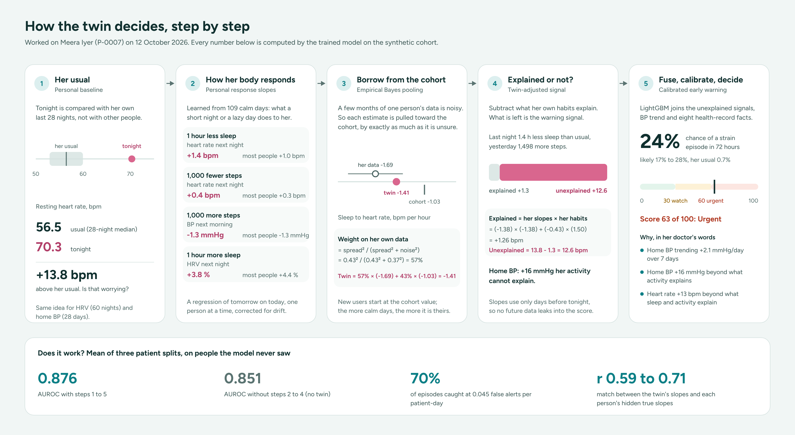</p>

| Step | What it does | Worked on Meera Iyer, 12 Oct |
|---|---|---|
| **1. Personal baseline** | Compares tonight with the person's own last 28 nights (heart rate, home BP) and 60 nights (HRV) | Usual heart rate 56.5 bpm, tonight 70.3: **+13.8 bpm** |
| **2. Personal response slopes** | On calm days, learns how tomorrow's heart rate, HRV and BP move with today's sleep and steps | 1 hour less sleep raises her heart rate by **1.4 bpm** (most people 1.0) |
| **3. Empirical Bayes pooling** | Mixes her slope with the cohort's, weighted by how sure the estimate is (DerSimonian and Laird) | Weight on her data **57%**: 57% × (-1.69) + 43% × (-1.03) = **-1.41** |
| **4. Twin-adjusted signal** | Tonight's change minus the part her own habits explain | Explained +1.3 bpm, so **+12.6 bpm unexplained**; BP **+16 mmHg** unexplained |
| **5. Fusion and calibrated alert** | LightGBM on the twin signals, BP trend and eight record facts; Platt calibration; thresholds from a false-alert budget; SHAP reasons | **24%** chance in 72 hours (her usual 0.7%), score **63: urgent** |

- **Why it is different.** Most systems compare tonight with an average person. Pratibimb compares tonight with what this person's own body would do after the night she actually had.
- **Proven, not assumed.** The synthetic data hides each person's true slopes; the twin recovers them (r 0.59 to 0.71) and beats one-slope-for-everyone on every response.
- **What-if on her own body.** "Walk 30 minutes a day" lowers Meera's predicted BP by her own slope (-4.4 mmHg). Risk is re-scored only through causes (sleep, activity, missed doses), and the model is built so more sleep or walking can never raise risk.
- **No future leaks in.** Every slope and baseline uses only earlier days; `backend/tests/test_leakage.py` checks it.

Full explanation with formulas, pseudo-code and limits: [`docs/ALGORITHM.md`](docs/ALGORITHM.md).

## Results

Synthetic cohort, 240 patients, 28,685 patient-days, 342 episodes. Patient-level 5-fold cross-validation, **repeated on three different patient splits**; every number is the mean of the three, measured on patients the model never saw.

**Early warning (72 hour horizon)**

| Model | AUROC | AUPRC | Episodes caught at the budget | Caught 48 h or more ahead |
|---|---|---|---|---|
| Rule only (NightSignal-style) | 0.708 | 0.091 | 42% | 19% |
| Record only (EHR) | 0.578 (0.577 to 0.581) | 0.042 | 15% | 15% |
| Watch only, twin-adjusted | 0.804 (0.771 to 0.822) | 0.136 | 55% | 37% |
| Watch + home BP cuff, twin-adjusted | 0.870 (0.859 to 0.878) | 0.214 | 72% | 51% |
| Watch + cuff + record, no twin | 0.851 (0.832 to 0.862) | 0.189 | 64% | 45% |
| **Pratibimb: watch + cuff + record + twin** | **0.876** (0.870 to 0.884) | **0.218** | **70%** | **50%** |

- **Budget.** At most 0.045 false alerts per patient-day (one per 22 patient-days). Median lead 48 hours.
- **Twin lift.** Twin-adjusted features beat the same model without them on AUROC in 3 of 3 patient splits.
- **The cuff matters.** At 90% sensitivity the watch alone alerts in 233 of 242 infection-like windows; with the home BP cuff, 164. A cold raises heart rate; it rarely raises BP for a week.
- **Forecasts.** Day-1 mean absolute error: resting HR 2.5 bpm, systolic BP 6.2 mmHg; P10 to P90 coverage 73%.

**Twin recovery (does the twin learn the right person?)**

| Response | Correlation with the hidden truth | Error, twin | Error, population average | 80% interval coverage |
|---|---|---|---|---|
| Sleep to next-night resting heart rate | 0.71 | 0.28 | 0.40 | 72% |
| Walking to next-night resting heart rate | 0.66 | 0.09 | 0.12 | 76% |
| Walking to next-morning systolic BP | 0.67 | 0.30 | 0.42 | 74% |
| Sleep to next-night HRV | 0.59 | 1.32 | 1.60 | 75% |

**Honest limits**

- **Synthetic labels.** All numbers are on a seeded synthetic cohort; real-world performance will be lower. Published anchors for context: NightSignal (infection) 80% sensitivity, EDI AUROC 0.76.
- **The twin carries the lift; the record adds ranking, not timing.** The twin beats no twin on every split. The record raises AUROC and AUPRC a little but not sensitivity at the budget, which ranges from 58% to 77% across splits anyway. Its real job is reading the watch correctly (beta blockers, diabetes), the static risk panel and the what-if on medicine adherence.
- **Single-split numbers vary.** Sensitivity at the budget moves by up to 19 points between patient splits of 240 people, which is why every headline is a three-split mean.

Full numbers, calibration, features and limits: [`docs/MODEL_CARD.md`](docs/MODEL_CARD.md).

## Screenshots

**Doctor console**

| Today: who needs attention | Twin page: summary, reasons, personal physiology |
|---|---|
| 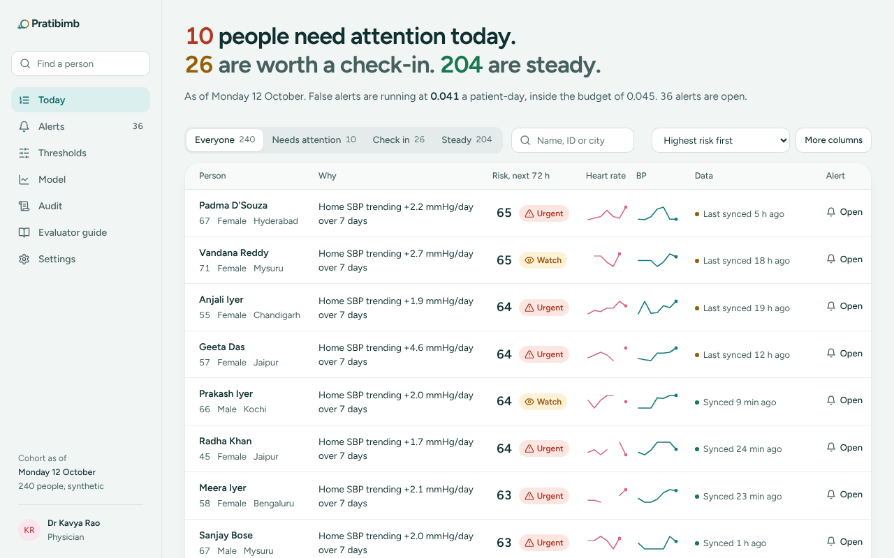 | 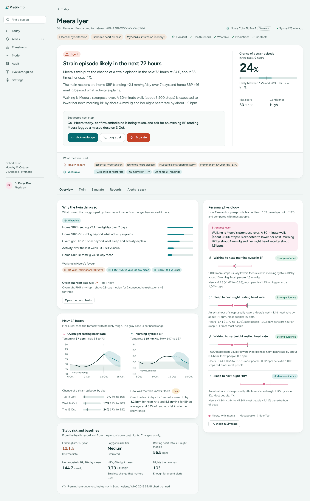 |

| Twin tab: three linked charts and the live stream | Simulate: her own slopes, next 72 hours and an ordinary week |
|---|---|
| 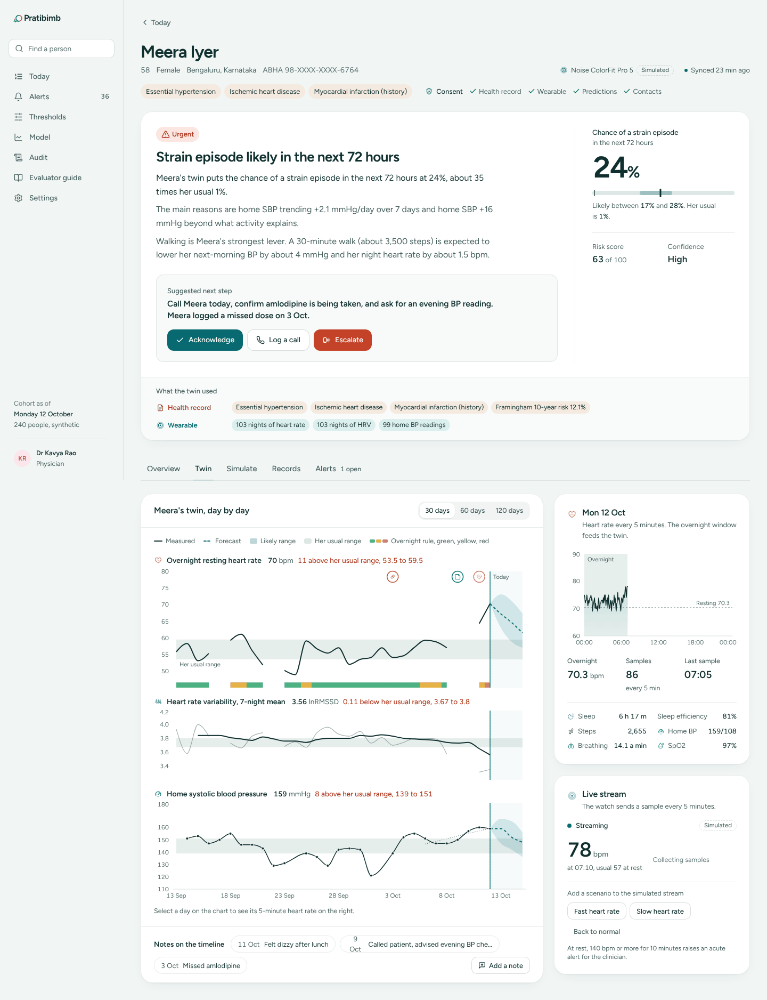 | 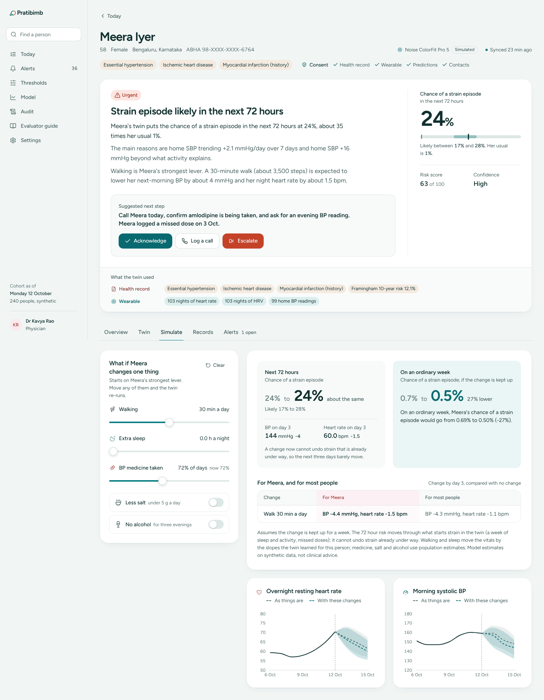 |

| Alerts inside a false-alert budget | Model card with repeated-split metrics |
|---|---|
| 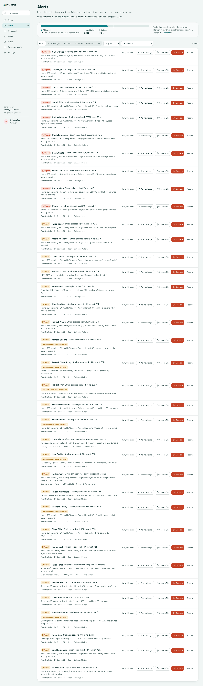 | 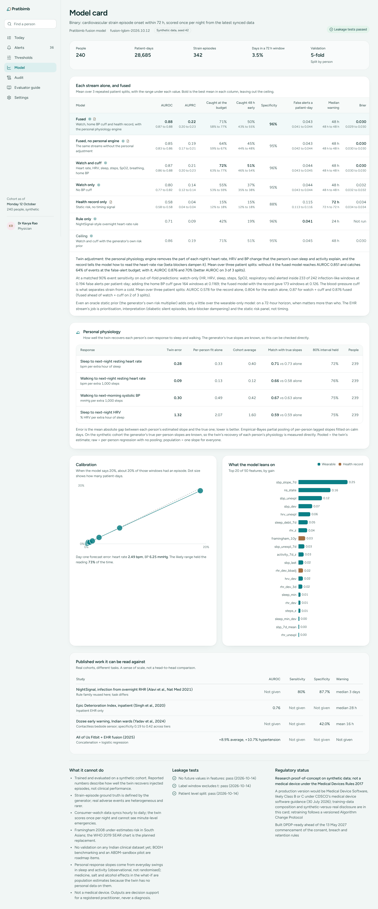 |

**Patient view**

| Status in words, compared with her usual | Hindi with read-aloud | SOS: the consented check-in ladder | New user still calibrating |
|---|---|---|---|
| 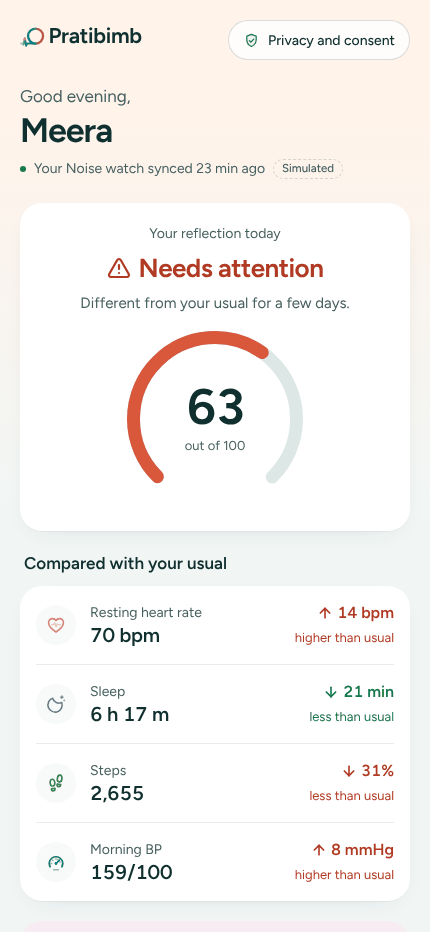 | 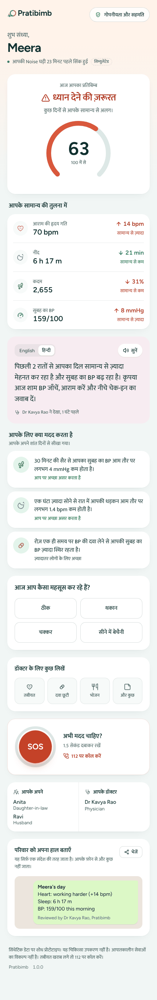 | 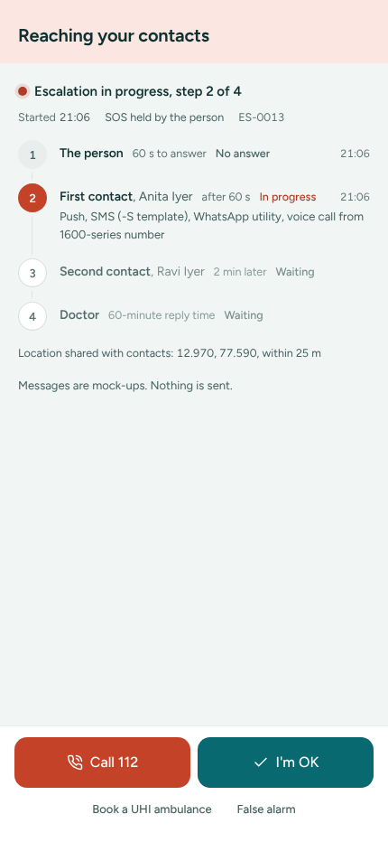 | 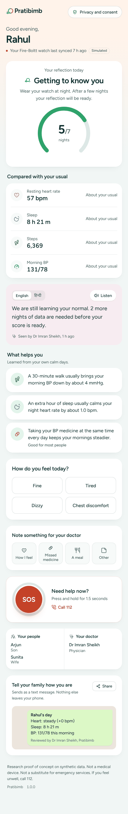 |

More in [`docs/screenshots/`](docs/screenshots/): landing page, records, alert explanation, thresholds replay, audit log, evaluator guide.


## Technical stack, AI/ML model and framework details

| Layer | Choice |
|---|---|
| **Data generation** | Python, NumPy, pandas; Synthea-shaped FHIR R4 EHR; daily wearable stream with planted personal response slopes, lifestyle phases, labelled episodes and unlabelled confounders; seeded (`python -m twin.data.generate`) |
| **Personal Physiology Engine** | Per-person lagged regressions with AR(1)-inflated errors; DerSimonian and Laird empirical Bayes pooling; expanding-window slopes so no future day leaks in |
| **Prediction model** | LightGBM binary classifier; Platt calibration; five fold models as the uncertainty band; SHAP TreeExplainer; NightSignal-style rule alongside |
| **Forecasts** | 18 LightGBM quantile models (resting HR and systolic BP, days 1 to 3, P10, P50, P90) |
| **Static risk** | Framingham 2008 10 year CVD risk, polygenic risk tier |
| **API** | FastAPI, Pydantic v2, SQLite (alerts, escalations, consent, annotations, thresholds, append-only audit), Server-Sent Events for the live stream |
| **Front end** | React 18, TypeScript, Vite, Tailwind CSS, Recharts, framer-motion; Figtree and Mukta (Devanagari), self-hosted; hand-built animated SVG brand and health glyphs |
| **Standards** | FHIR R4, ABDM WellnessRecord bundle (NRCeS profiles), SNOMED CT, LOINC |
| **Quality** | pytest (25 tests incl. three leakage tests), Docker Compose, Makefile |

## Video

- **Walk-through (20+ minutes):** _add the unlisted YouTube link here_
- **Script with timings:** [`docs/DEMO_SCRIPT.md`](docs/DEMO_SCRIPT.md)

## Open-source licence

MIT. See [`LICENSE`](LICENSE). Third-party packages keep their own licences (LightGBM, scikit-learn, SHAP, FastAPI, React, Recharts, Tailwind, framer-motion, Figtree and Mukta under the SIL Open Font Licence).

## Architecture diagram

<p align="center">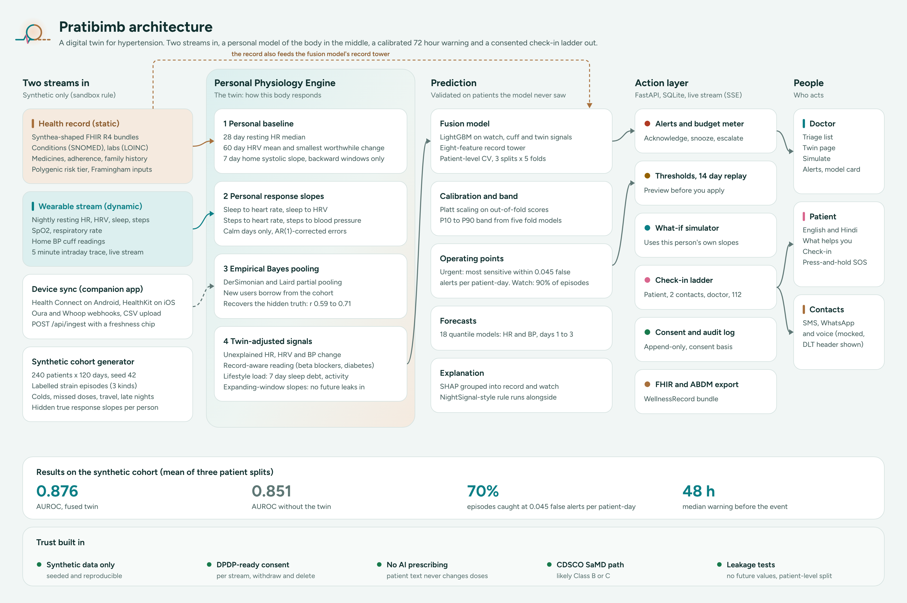</p>

PDF: [`docs/architecture.pdf`](docs/architecture.pdf) (also `.svg`, `.png`).

## Presentation

- **Deck:** [`docs/presentation.pdf`](docs/presentation.pdf) _(add before submission)_

## Run it

**Requirements:** Python 3.12+, Node 20+ (or Docker).

```bash
make setup && make demo        # data, model, front end, serve on http://localhost:8000
```

Step by step:

```bash
pip install -r backend/requirements.txt
cd frontend && npm install && npm run build && cd ..
cd backend
python -m twin.data.generate        # 240 patients x 120 days (a few seconds)
python -m twin.models.train         # twin, fusion, ablations, forecasts, model card (about 5 min on 2 cores)
python -m pytest -q                 # 25 tests incl. leakage tests
uvicorn twin.api.main:app --port 8000
```

Open `http://localhost:8000` (landing), `/console` (doctor), `/me/P-0007` (patient view), `/api/docs` (OpenAPI). Docker: `docker compose up --build`. Front end with no backend: `cd frontend && npm run dev:mock`. On Windows, run the step-by-step commands (no `make` needed).

**Online demo (Vercel).** Import this repository in Vercel and press Deploy: `vercel.json` sets the build (`npm run build:demo`), the output folder and the page routing, with no environment variables. The demo replays real output from the trained model. After retraining, refresh its data with the API running: `python scripts/export_snapshot.py`.

## Connecting real devices: the companion app

- **Why an app.** Apple Health and Android Health Connect live on the phone with no cloud API, so no website can read them.
- **What it does.** A thin companion app reads the phone's health store with the patient's permission and posts daily aggregates to `POST /api/ingest`.
- **Coverage.** Health Connect on Android covers Samsung, Garmin, Oura, Whoop, Withings, Amazfit and Xiaomi; HealthKit covers Apple Watch. Oura and Whoop also work by OAuth and webhooks; anyone can upload a CSV.
- **Honest freshness.** Budget watches sync hourly to daily, so the twin scores once a night and every card shows when data last arrived.
- **Out of scope.** Fitbit Web API (off 30 Oct 2026), Garmin's paused programme, Samsung's partner-only SDK. Details: [`docs/DEVICE_SYNC.md`](docs/DEVICE_SYNC.md).

## Compliance posture

- **DPDP-ready.** Separate consent per stream, opt out of AI while keeping records, withdraw and delete, emergency-contact consent in advance, 18+ gate, masked ABHA.
- **Audit.** Append-only log with the consent basis of every action.
- **No AI prescribing.** Patient text never changes doses (Telemedicine Practice Guidelines 2020).
- **Regulatory path.** A production version would be Medical Device Software under CDSCO's 30 July 2026 guidance (likely Class B or C). Details: [`docs/COMPLIANCE.md`](docs/COMPLIANCE.md).

## Data sources

All training data is synthetic and generated here. Public papers set the generator's parameters only (NightSignal thresholds, AIS HRV guidance, IDC India device mix, Framingham 2008). See [`docs/DATA_SOURCES.md`](docs/DATA_SOURCES.md).

## Repository layout

```
backend/
  twin/data        synthetic EHR + wearable generators, Synthea loader, cohort builder
  twin/features    leakage-safe feature matrix, twin-adjusted signals
  twin/models      physiology engine, fusion (repeated CV), forecasts, Framingham, NightSignal rule, trainer
  twin/engine      cohort state, twin views, summaries, alerts + budget, escalation ladder, FHIR, live stream
  twin/api         FastAPI app (docs/API.md)
  tests/           pytest suite, including leakage tests
  artifacts/       trained models and the model card
frontend/          React app: pages, charts, brand (logo and glyphs), mock and hosted-demo data
docs/              algorithm, model card, API, design, device sync, compliance, data sources, demo script, diagrams
scripts/           model card and diagram renderers, hosted-demo snapshot export
vercel.json        online demo build settings
```

## Submission checklist

- [x] Public GitHub repository, folder `Team Pratibimb_IIM Lucknow`
- [x] README with team details, title, problem statement and use case, stack and model details
- [ ] Video of at least 20 minutes: _add link_
- [x] Open-source licence (MIT)
- [x] Architecture diagram (`docs/architecture.pdf`)
- [ ] Presentation PDF or PPT: _add `docs/presentation.pdf`_
